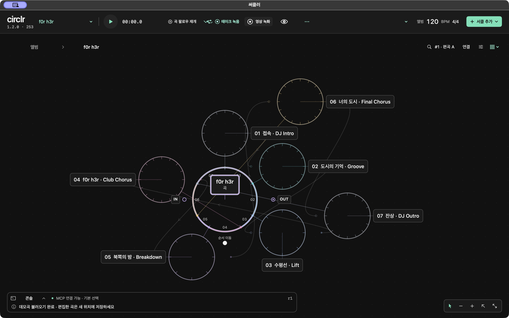
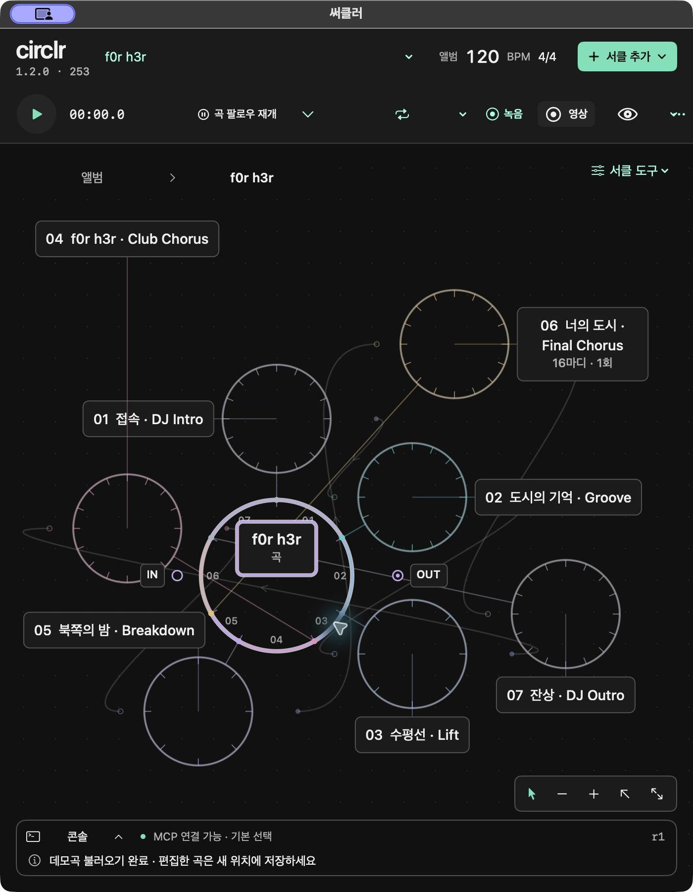

# circlr

송라이터와 편곡자를 위한 macOS 원형 음악 작업 공간입니다.

[English](README.md) · 한국어

연결된 섹션으로 곡을 구성하고, 원형 타임라인에서 MIDI·오디오를 편집합니다. 하나의 캔버스에서 곡 전체와 세부 편집을 오갈 수 있습니다.



이 공개 소스 사본은 **1.2.0 build253**의 앱 코드를 유지합니다. 소스 공개를 위한 구성으로, 새 제품 릴리스를 뜻하지 않습니다. 앱 화면은 한국어입니다.

## 음악 작업

- 재사용 섹션·반복·편곡 변형으로 곡의 흐름을 구성합니다.
- MIDI 노트·스텝을 편집하고, 오디오를 가져와 분할·페이드를 적용합니다.
- 악기·이펙트를 연결하고 오토메이션·바운스·원본 복원을 다룹니다.
- 로컬 명령 콘솔과 MCP로 프로젝트를 조회하고 편집합니다.

앱 내부의 계정 대화는 기본으로 비활성화돼 있습니다. 물리 청취·광범위 한글 IME·기존 영상 70ms 간격 문제·모든 장치 및 plug-in 호환성은 이 사본의 검증 범위에 포함하지 않습니다. [검증과 제한](docs/validation.md)



두 화면은 build253 실제 앱을 촬영한 원본입니다. [촬영 정보](docs/images/README.md)

## 소스 빌드

**macOS 14+, active developer directory로 선택한 full Xcode 26+, Python 3**가 필요합니다. 선택 사항인 agent-kit 설치에는 **Python 3.11+**가 필요합니다. 기존 native 검증 플랫폼은 Apple Silicon입니다. 이번 로컬 공개 사본 검사는 Xcode 27.1 / Swift 6.4에서 실행했습니다. CI는 macOS 26과 Xcode 26.6을 선택하도록 구성했으며 수정 후 결과는 [검증 기록](docs/validation.md)에서 별도로 다룹니다.

```sh
./scripts/build-app.sh
```

앱과 helper·데모·agent kit를 `dist/써클러.app`에 만듭니다. 로컬 패키지는 ad-hoc 서명이며 Apple notarization을 받지 않았습니다. 빌드 명령은 앱을 실행하거나 설치하지 않습니다. [빌드와 테스트](docs/build.md)

## 문서

- [구조](docs/architecture.md)
- [로컬 MCP와 agent kit](mcp/README.md)
- [검증과 알려진 제한](docs/validation.md)
- [데모 출처와 권리](docs/demo-sources.md)
- [기여 안내](CONTRIBUTING.md) · [변경 기록](CHANGELOG.md)

## License

코드·문서·프로젝트 artwork에는 [MIT License](LICENSE)를 적용하며 [제3자 고지](THIRD_PARTY_NOTICES.md)를 함께 보존합니다.

동봉 음악에는 별도 조건이 있습니다. 고지를 유지한 수정하지 않은 데모는 circlr와 fork에 동봉해 재배포할 수 있습니다. 타악기 녹음6개는 CC0, 클래식 원본 MIDI·LilyPond는 Public Domain입니다. 곡과 새 편곡 전체를 MIT·CC0로 제공하는 것은 아닙니다. [데모 조건](Resources/Demos/DEMO-LICENSE.md) · [클래식 편곡 조건](Resources/Demos/classical/ARRANGEMENT-TERMS.md)
